# Chrono Node

Chrono Node is an offline-first desktop smart clock built on the ESP32-2432S028R
("Cheap Yellow Display", CYD) with an external DS3231 RTC as its time source.

**Current state (M6, M8, M9, M10):** a 24-hour clock driven by the DS3231 (which holds UTC), shown in
local time using a configurable POSIX timezone stored in NVS. Wi-Fi with a setup portal, mDNS
(`chrono-node.local`) and NTP that keeps the DS3231 accurate. The UI uses bold anti-aliased
gradient digits, rolling transitions and colours that follow the time of day, plus a dimmed
night mode on a schedule, weather from Open-Meteo, and touch navigation between the clock,
forecast, info and settings screens, plus a settings page in the browser at
`http://chrono-node.local`, and firmware updates over Wi-Fi with automatic rollback. See
[docs/ROADMAP.md](docs/ROADMAP.md) for upcoming milestones.

| Clock with weather | Forecast screen |
|--------------------|-----------------|
| 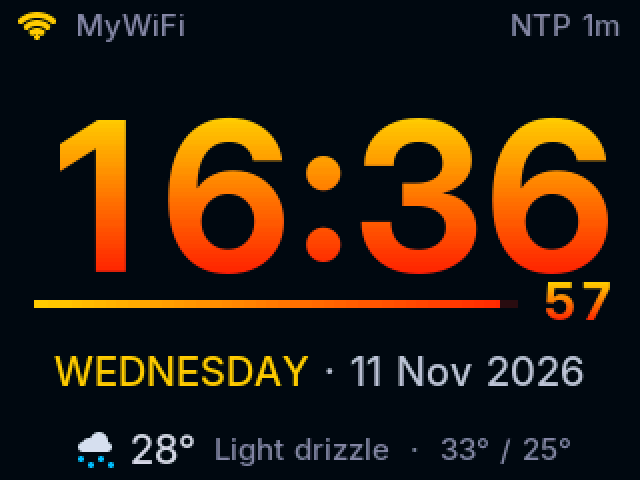 | 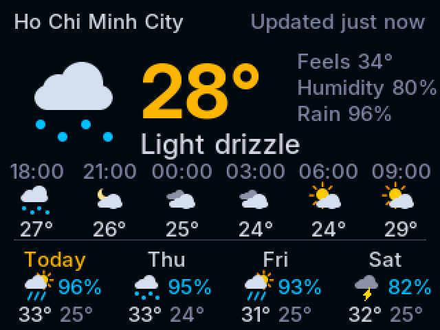 |
| **Settings (touch)** | **Info** |
| 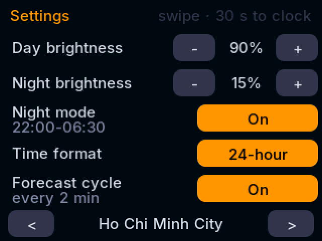 | 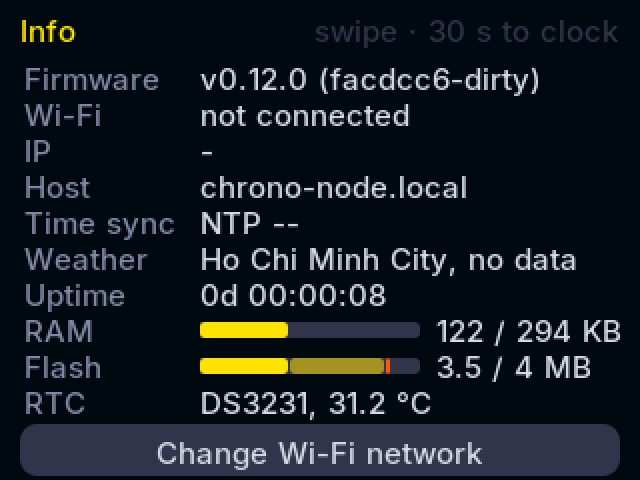 |

| Night mode | Sunrise | Day |
|------------|---------|-----|
| 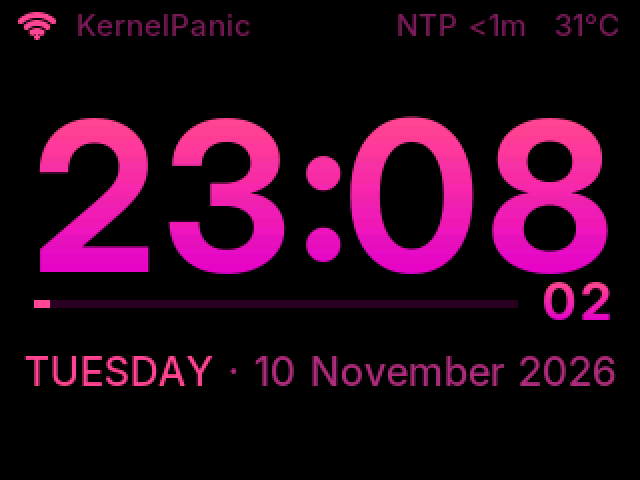 | 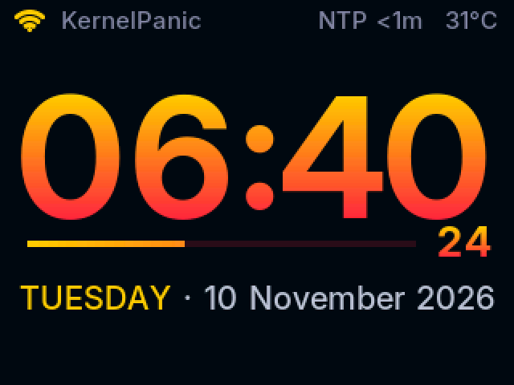 | 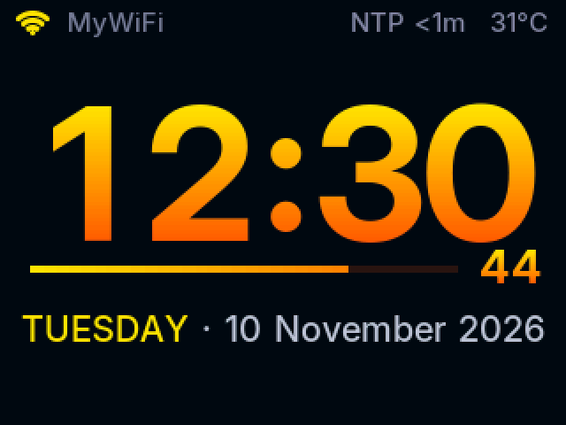 |
| **Sunset** | **Evening** | **Palettes (`TEST PALETTE`)** |
| 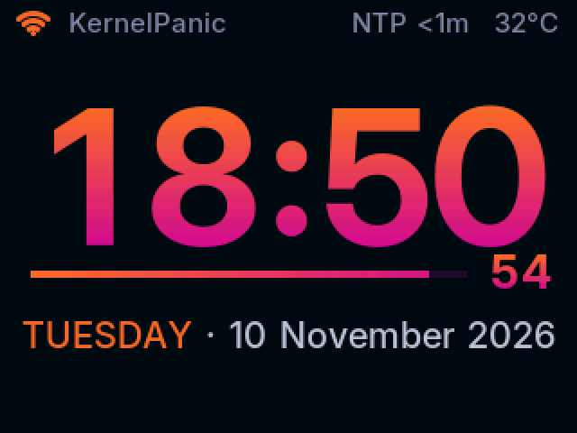 | 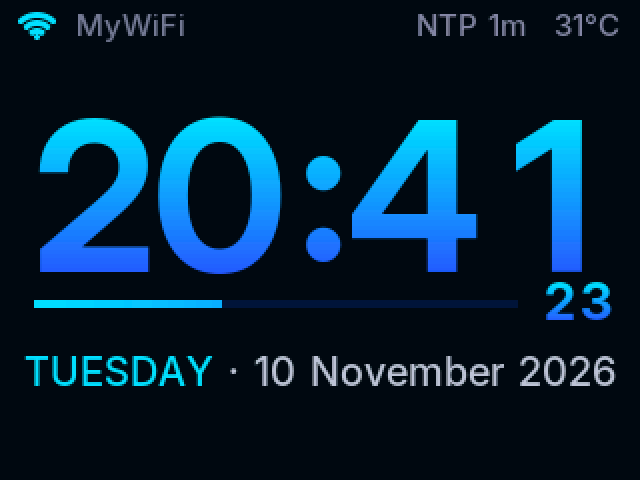 | 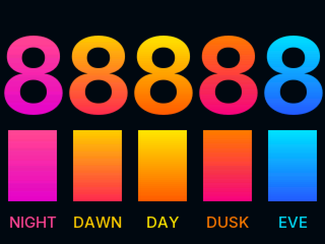 |

## Display

- **Status bar:** Wi-Fi signal and network name, NTP sync age (`NTP 5m`, amber when stale),
  and the DS3231 temperature (±3 °C; it's the RTC chip's own sensor). The DS3231
  temperature is shown only when there's no weather data.
- **Time:** HH:MM in 104 px Inter Bold with a vertical colour gradient. Changed digits roll
  upwards over 300 ms. Every digit uses a fixed-width cell, so the time never shifts sideways.
- **Minute bar:** fills over the minute with a horizontal gradient. The seconds sit at its
  right end.
- **Date:** the weekday in the accent colour, then the date.
- **Bottom line:** current weather (icon, temperature, condition, today's high/low). A notice
  replaces it when needed: RTC lost-power warning (red) or Wi-Fi setup instructions (cyan).
- **Colours by time of day** (on a deep navy background), blended minute by minute in HSV
  so transitions stay saturated: night hot pink→magenta, sunrise (~06:30) gold→red-pink,
  day (09:00–16:00) yellow→orange, sunset (~18:30) orange→magenta, evening (20:00–21:15)
  cyan→blue. The colours are fully saturated, because pastels look washed out on the IPS
  panel. They were picked on the device from side-by-side candidates (`TEST PALETTE`).
- Long dates (e.g. `WEDNESDAY` in September) shorten the month, then the weekday, to fit.
- Glyphs are rendered white-on-black into sprites, then tinted per pixel, so the gradients
  keep their anti-aliasing. Nothing flickers. An animation frame takes a few ms.
- The CYD's RGB LED is switched off at boot.

## Touch and screens

- **Screens**, in swipe order: Clock → Forecast → Photo → Info → Settings, then back to
  Clock. Swipe left for the next screen and right for the previous one. The forecast is
  skipped until weather data exists, and the photo screen while there are no photos. Screen changes happen behind a quick backlight dip.
- After 30 s without touch the clock comes back. The automatic forecast cycle (see Weather)
  still runs on the clock screen.
- **Settings** (tap):
  - day brightness (±10 %) and night brightness (±5 %)
  - night mode on/off (the schedule itself is set with `NIGHT HH:MM HH:MM`)
  - 12/24-hour time
  - forecast cycle on/off
  - weather location, chosen from the last 5 used locations (`<` / `>`). New locations are
    added with `WEATHER CITY`/`WEATHER LOC`, and later from the web UI (M9).
- **Info** shows firmware, Wi-Fi and signal, IP, host name, NTP sync, weather age, uptime,
  memory and the RTC. It refreshes every 2 s.
- **At night**, any touch raises the backlight to the day level for 10 s.
- **12-hour mode** shows AM/PM before the minute bar. Hours 1–9 drop the leading digit and
  the time stays centred.
- **Touch hardware:** the XPT2046 controller sits on its own SPI bus (CLK 25, MOSI 32,
  MISO 39, CS 33), separate from the display. Only firm presses give positions, because
  resistive panels read unreliable coordinates while the finger lands or lifts.
- **Calibration:** run `TOUCH CAL` and press each of the 4 crosshairs firmly, ideally with a
  stylus. An affine fit (least squares) also corrects a touch panel that is slightly rotated
  against the display, which is the case on this unit. The result is saved in NVS. Until
  calibrated, a generic mapping is used, which can be ~15 px off near the edges.
  `TOUCH` prints raw and mapped readings for 10 s.

## Web settings

Open `http://chrono-node.local` (or the clock's IP, shown on the Info screen) from a device
on the same network. The page shows live status and changes every setting while the clock
stays online:

- **Status:** time, Wi-Fi, IP, NTP sync, RTC, weather, current screen, uptime, memory.
- **Display:** day/night brightness, night mode and its hours, 12/24-hour time, forecast cycle.
- **Time:** time zone by name (common zones are mapped to POSIX strings, **Detect** uses the
  browser's zone, or enter a custom POSIX string), NTP server, **Sync now**, and **Set clock
  from this device** for networks without NTP (accurate to about a second).
- **Weather location:** search a city or district (Open-Meteo geocoding, top 5 matches with
  province, country and population, *Vietnam only* on by default), or enter coordinates, or
  pick a recent location.
- **Wi-Fi & device:** open the setup portal, forget the Wi-Fi network, reboot.

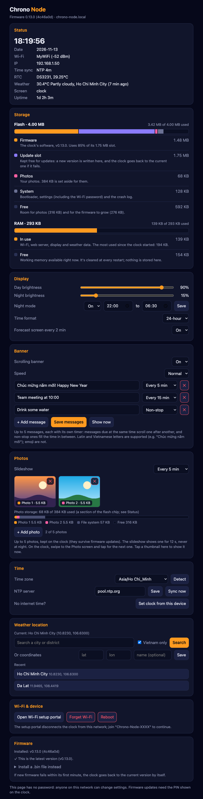

The web server runs in the network task and is stopped while the setup portal is open
(the portal needs port 80). Changes are sent as **console commands** to the main task, so
they go through the same validation as the serial console, and all RTC and display work
stays in one task.

> **No password:** anyone on the same network can change settings (an open question; see #18).

### JSON API

| Endpoint | Description |
|----------|-------------|
| `GET /api/status` | Live status: time, Wi-Fi, NTP, RTC, weather, screen, uptime, memory |
| `GET /api/settings` | All settings, including recent locations |
| `GET /api/geocode?q=<name>[&country=VN]` | Up to 5 location matches |
| `POST /api/command` | Body (`text/plain`): one console command. Returns `202 {"queued":true}` |
| `GET /api/photo?n=<slot>` | A stored photo (JPEG) |
| `POST /api/photo` | Multipart field `photo`: a baseline JPEG ≤ 64 KB, saved in a free slot. Returns `200 {"ok":true,"slot":n}` or `400 {"error":...}` |
| `POST /api/ota/pin` | Shows a one-time update PIN on the clock (2 min) |
| `POST /api/ota?pin=NNNN` | Multipart firmware upload. Returns `200`, `403` (PIN) or `500` (image) |

Allowed commands: `TZ`, `NTP SERVER`, `NTP SYNC`, `BRIGHT`, `NIGHT`, `FORMAT`,
`WEATHER LOC|CYCLE|UPDATE`, `SETEPOCH`, `WIFI PORTAL|FORGET`, `REBOOT`, `SCREEN`, `BANNER`,
`PHOTO`.
Blocking or diagnostic commands (`SHOT`, `TEST`, `TOUCH`) aren't allowed. Example:

```bash
curl -X POST -H 'Content-Type: text/plain' --data 'BRIGHT DAY 80' http://chrono-node.local/api/command
```

## Firmware updates (OTA) and releases

**From the web page** (*Firmware* section):

1. Click **Show PIN on the clock**. A 4-digit PIN appears at the bottom of the clock's
   screen for 2 minutes. The page has no password, so the PIN proves someone is standing
   at the clock before firmware can be replaced.
2. Enter the PIN, choose `chrono-node-fw.bin` from a release (or `.pio/build/cyd/` after
   `pio run`) and click **Install**. The upload goes to the inactive OTA slot (about 35 s
   over Wi-Fi), with progress shown on the clock and in the page, and then the clock reboots.

From a terminal (the PIN still has to be read off the clock):

```bash
curl -X POST http://chrono-node.local/api/ota/pin
curl -F firmware=@.pio/build/cyd/chrono-node-fw.bin "http://chrono-node.local/api/ota?pin=1234"
```

**Rollback:** a newly installed image starts as *pending verify* and is confirmed after
60 s of normal running (`[OTA] New firmware confirmed`). If it crashes or resets before
that, the bootloader returns to the previous firmware on the next boot. `OTA` on the serial
console shows the running slot and its state.

To test rollback, build an image that crashes after 20 s, install it over OTA, and check
that the clock comes back on the previous slot:

```bash
PLATFORMIO_BUILD_FLAGS="-DCHRONO_CRASH_AFTER_MS=20000" pio run
```

**Releases:** pushing a tag `vX.Y.Z` that matches `kFirmwareVersion` in `include/config.h`
runs `.github/workflows/release.yml`, which builds and publishes a GitHub release with:

| File | Use |
|------|-----|
| `chrono-node-fw.bin` | OTA image for the web page |
| `chrono-node-fw-full.bin` | Complete image for a **new or recovered** board. **Erases all settings, including Wi-Fi** |
| `SHA256SUMS` | Checksums |

```bash
git tag v0.10.0 && git push origin v0.10.0
esptool.py --chip esp32 --port /dev/cu.usbserial-XXXX write_flash 0x0 chrono-node-fw-full.bin
```

> **Warning:** the full image covers the whole flash from 0x0, including the settings
> area (NVS at 0x9000–0xDFFF), which `merge_bin` fills with blank bytes. Writing it erases
> Wi-Fi credentials, the time zone, recent locations and touch calibration. To update a
> configured clock, use the OTA image (web page) or `pio run -t upload`, which leave the
> settings alone.

A USB upload (`pio run -t upload`) always resets the boot slot to `app0`.

## Weather

- The source is [Open-Meteo](https://open-meteo.com) (free, no API key): current conditions,
  the next 24 hours and 4 days. It's fetched over **HTTPS with certificate verification** every
  15 min while online, retrying after failures with backoff (1 min doubling up to 15 min).
- The default location is Ho Chi Minh City. Change it with `WEATHER CITY <name>` (looked up
  with Open-Meteo geocoding) or `WEATHER LOC <lat> <lon> [name]`. The location is saved in NVS.
- **Forecast screen:** the current conditions with feels-like, humidity and rain chance; the
  next hours in 3 h steps; and today plus 3 days with rain probability. Until touch arrives
  (M6), it cycles in every 2 minutes at second 45 for 10 s, behind a quick backlight dip.
  It's never shown at night or while a notice is shown. Turn it off with `WEATHER CYCLE OFF`.
  `WEATHER SHOW` shows it for 30 s.
- **Offline:** the last data stays on screen. After 2 h it's dimmed and marked "old". The
  data is kept in RAM only, so a reboot without network shows no weather.
- Icons are drawn from anti-aliased circles, lines and rounded rectangles (sun, moon, clouds,
  drizzle, rain, showers, thunder, snow, fog), so there are no image assets. In night mode
  they're drawn in the dim night colour.
- TLS uses Mozilla's root store, converted into the ESP-IDF bundle format by
  `tools/gen_ca_bundle.py` (`src/certs/ca_bundle.h`, 118 roots, 55 KB). To refresh it:

```bash
uv run --with cryptography tools/gen_ca_bundle.py
```

## Scrolling banner

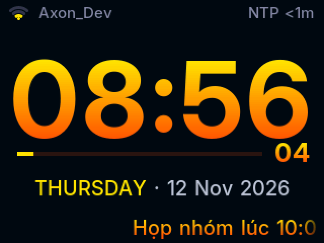

Your own short messages scroll across the bottom line of the clock face.

- **Messages:** up to 5, each up to 120 bytes of UTF-8. They're shown one at a time in rotation.
- **Characters:** Latin and Vietnamese letters are supported (e.g. "Chúc mừng năm mới"), plus
  curly quotes, dashes, • and …. Emoji and other scripts aren't in the font, so they're skipped.
- **Timing:** by default a message scrolls every minute, starting at second 15. You can choose
  every 2–60 minutes, or continuously (one after another with a 2 s pause).
- **Speed:** slow (45 px/s), normal (70 px/s) or fast (110 px/s). The text uses the clock's
  time-of-day colours and fades out at both edges.
- **Sharing the screen:**
  - While a message scrolls, it replaces the weather line.
  - Notices (Wi-Fi setup, update PIN, RTC warnings) take priority over the banner.
  - Switching screens stops the current message. This includes the forecast cycle and
    swiping.
  - The banner keeps running at night, in the night colours.
- **Web page:** the Banner section turns it on or off, sets how often and how fast, and edits
  the messages. **Save messages** replaces the whole list; **Show now** scrolls the next
  message immediately.
- **Serial console:** `BANNER` commands (listed below).

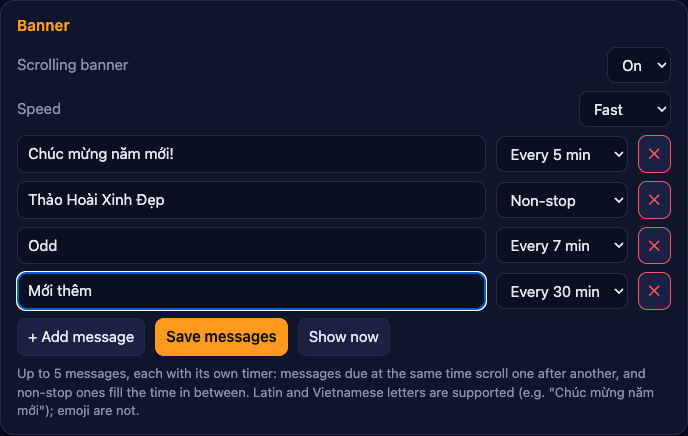

## Photos

Your own photos can be shown on the clock, for example a picture of someone you love.

- **Adding a photo:** on the web page's Photos section, choose **+ Add photo** and pick a
  picture (JPEG, PNG, or HEIC on an iPhone). The browser shows exactly what the clock will
  show: drag to frame it, and use the slider or mouse wheel to zoom. **Upload to clock**
  sends a 320×240 JPEG of at most 64 KB (usually 20–40 KB) and shows it on the clock.
- **What's sent:** the original photo never leaves your phone or computer; only the small
  cropped version is uploaded. Photos aren't part of the firmware or the repository.
- **Storage:** up to 5 photos, kept in the LittleFS data partition (384 KB). Firmware
  updates over the web or `pio run -t upload` keep them. Writing the `-full` image at 0x0
  (see Firmware updates) erases them, like the Wi-Fi settings.
- **On the clock:**
  - The **Photo** screen is in the swipe order. Tap it for the next photo. It returns to the
    clock after 30 s.
  - The **slideshow** shows the next photo for 12 s every 5 minutes, at second 28, so it
    doesn't collide with the banner or forecast. You can choose every 1–60 minutes, or off.
  - The slideshow never runs at night, or while a notice is showing (setup, update PIN).
    You can still swipe to your photos at night.
- **Web page:** thumbnails of the stored photos with each one's size. Tap one to show it on
  the clock now, or ✕ to delete it. A storage bar shows each photo's share, file-system
  overhead (files use whole 4 KB blocks) and free space. The Status section shows RAM as a
  bar too: used now, the peak since boot, and free.
- **Serial console:** `PHOTO` commands (listed below). Photos larger than the screen, for
  example uploaded with curl, are scaled down by 1/2, 1/4 or 1/8 and centred. Progressive
  JPEGs are rejected because the decoder (tjpgd) can't read them.

```bash
curl -F "photo=@me.jpg" http://chrono-node.local/api/photo   # baseline JPEG, max 64 KB
```

## Brightness and night mode

- The backlight (GPIO21) is driven by 12-bit PWM with gamma correction, so 50% looks like
  half brightness. Changes fade smoothly, and the screen fades in at boot.
- **Night mode** runs on a schedule (default 22:00–06:30). The backlight dims to the night
  level, the background turns pure black, the digits use the night palette, and the status
  and date text turn dim pink. The switch happens behind a fade to dark, so the repaint is
  never visible.
- The levels default to 90% by day and 15% by night. Both levels and the schedule are saved
  in NVS (`BRIGHT`, `NIGHT` commands below).
- There's no automatic brightness. The CYD's on-board light sensor (LDR on GPIO34) read 0
  under any light on this unit, whether covered or under a phone flashlight. An external I2C
  light sensor could add it later (see roadmap M14).

Fonts are generated from the Inter variable font (SIL Open Font License, see
`tools/fonts/OFL.txt`) into `src/fonts/*.h` by `tools/gen_fonts.py`. The headers are
committed, so builds need no extra tools. To change sizes or weights:

```bash
uv run --with freetype-py tools/gen_fonts.py
```

### Screenshots

`SHOT` on the serial console streams the screen back over USB. The helper script saves it as
a PNG:

```bash
uv run --with pyserial --with pillow tools/screenshot.py -o shot.png
uv run --with pyserial --with pillow tools/screenshot.py -o setup.png --send "WIFI PORTAL"
uv run --with pyserial --with pillow tools/screenshot.py -o wx.png --wait-for "[WEATHER] " --send "WEATHER SHOW"
```

Opening the port resets most CYDs, so the script waits for boot first (`--wait`, default
8 s). `--wait-for` keeps reading until a log line appears, e.g. once the weather has loaded.
A capture takes ~15 s, during which the clock pauses. The frame is checked and the capture
retried if log output from another task got mixed into it. Readback needs
`SPI_READ_FREQUENCY` at 6 MHz; at 20 MHz the CYD returns bit-shifted colours.

The capture reads the display's memory, so it can't show panel-level problems such as
inversion. Use `TEST` to check the real panel; see Troubleshooting.

## Time model

- The DS3231 is the source of truth and **always stores UTC**.
- Local time = DS3231 UTC + the POSIX `TZ` string (default `<+07>-7`, change it with `TZ`).
- The display always reads the DS3231, so the clock works without any network.
- Between NTP syncs the DS3231 (±2 ppm) is the reference. The ESP32 system clock (used by
  TLS/SNTP) is seeded from it on a second edge, and corrected when it drifts more than 200 ms.
- When NTP time arrives (on every Wi-Fi connect, then every 6 h), the DS3231 offset is measured
  on its next second edge. If it is off by more than 100 ms, or the DS3231 lost power, it is
  rewritten exactly on the system second boundary. Writing the seconds register restarts the
  DS3231's internal 1 Hz countdown, so both clocks tick together, typically within a few ms.
- Each measurement is logged, with a drift estimate in ppm once two measurements are an hour
  or more apart.

## Hardware

| Part | Notes |
|------|-------|
| ESP32-2432S028R (CYD) | 320×240 TFT (this unit: ST7789 IPS), CH340 USB-UART |
| DS3231 RTC module | I2C address `0x68` (ZS-042 modules also show an EEPROM at `0x57`) |

### Wiring: use the CYD **LEFT** 4-pin connector

```text
CYD LEFT CONNECTOR           DS3231
3.3V   --------------------> VCC
GPIO27 --------------------> SDA
GPIO22 --------------------> SCL
GND    --------------------> GND
```

Don't use the right "Extended IO" connector. It has no 3.3V pin, and GPIO21 is the
CYD's TFT backlight. The firmware always calls `Wire.begin(27, 22)` explicitly.

> ZS-042 style DS3231 modules include a trickle-charge circuit intended for LIR2032 cells.
> If you fit a non-rechargeable CR2032, consider removing the charge resistor or diode.

## Development setup (macOS)

```bash
uv tool install platformio      # or: brew install platformio / pipx install platformio
pio --version
```

VS Code with the PlatformIO IDE extension is optional. The CLI is enough.

## Build, flash, monitor

```bash
pio run                 # build -> .pio/build/cyd/chrono-node-fw.bin
pio device list         # find the board's port
pio run -t upload       # flash (add --upload-port <port> if several ports exist)
pio device monitor      # serial console, 115200 baud
```

All TFT_eSPI configuration lives in `platformio.ini` (`build_flags`), so a fresh
checkout builds without editing anything in the global PlatformIO packages directory.

## Connecting the device

1. Plug the CYD directly into the computer with a **data-capable** USB cable.
2. `pio device list` should show the CH340 bridge, e.g. `/dev/cu.usbserial-1210`,
   `USB VID:PID=1A86:7523`. macOS includes the CH340 driver. Boards with a CH9102
   appear as `/dev/cu.wchusbserial-*` and may need the WCH driver.
3. If uploading fails at high baud, the project already uses `upload_speed = 460800`
   (921600 is unreliable with the CH340). If auto-reset fails, hold **BOOT** while
   the upload starts connecting.

## Wi-Fi setup

The clock works without Wi-Fi. Network work runs in its own FreeRTOS task (core 0), so
connecting, scanning and the portal never pause the clock.

1. If no Wi-Fi credentials are saved, the clock opens a setup portal. The top line of the
   screen shows `Setup: join Wi-Fi Chrono-Node-XXXX`.
2. Join that open network from a phone. The captive page opens automatically, or browse to
   `http://192.168.4.1`.
3. Choose **Configure WiFi**, pick a **2.4 GHz** network, enter the password and save.
4. The status bar shows the network name, and the clock answers at `chrono-node.local`.

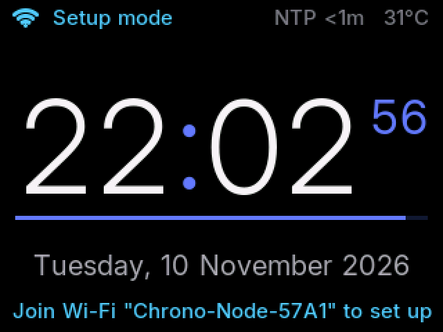

Credentials are stored in ESP32 NVS by the Wi-Fi stack, never in the repository.

Behaviour:
- Before each attempt the clock scans and connects to the **strongest** access point for the
  saved network, by BSSID. Office networks broadcast one name from many access points, and
  the ESP-IDF's own choice was often a distant one. After two failed attempts on an access
  point it moves on to the next strongest.
- The first 3 attempts are 2 s apart. After that the retry delay is 10 s, doubling up to
  5 min. The portal opens for 180 s only if the saved network isn't in range after boot.
- If credentials just entered in the portal fail, the portal reopens.
- A dropped connection is retried automatically with the same backoff.
- The portal has no firmware-update page, because the setup AP is open.

## Serial console

Firmware **never** writes the RTC at boot. Normal operation only reads the DS3231.
Open `pio device monitor` and type:

```text
SET 2026-11-08 14:32:51     # local wall-clock time, converted and stored as UTC
GET                         # current time, local and UTC
TZ                          # show the timezone
TZ <+07>-7                  # set and save a POSIX timezone (UTC+7, no DST)
TZ CET-1CEST,M3.5.0,M10.5.0/3   # example with DST rules
INFO                        # firmware/git revision, heap, partition, DS3231 temperature
WIFI                        # Wi-Fi state, SSID, IP, RSSI
WIFI PORTAL                 # open the setup portal (closes after 180 s if credentials exist)
WIFI FORGET                 # erase saved Wi-Fi credentials and open the portal
WIFI SCAN                   # visible 2.4 GHz networks: BSSID, channel, RSSI, security
NTP                         # server, last sync age, last measured DS3231 offset
NTP SYNC                    # sync now (busy pool servers may answer only after a retry, ~15 s)
NTP SERVER time.google.com  # set and save the NTP server (default pool.ntp.org), then sync
SHOT                        # stream the screen (use tools/screenshot.py)
TEST                        # labelled colour bars for 20 s (panel variant check)
TEST PALETTE                # the five day-cycle palettes side by side for 30 s
BRIGHT                      # show brightness levels and night schedule
BRIGHT DAY 90               # set and save the day backlight level (0-100 %)
BRIGHT NIGHT 15             # set and save the night backlight level
NIGHT 22:00 06:30           # set and save the night window (may wrap past midnight)
NIGHT OFF                   # disable night mode (NIGHT ON to re-enable)
WEATHER                     # location, current weather, 4-day forecast, last error
WEATHER UPDATE              # fetch now
WEATHER SHOW                # show the forecast screen for 30 s
WEATHER CITY Da Nang        # look up a city and save it as the location
WEATHER LOC 10.82 106.63 Home   # save a location by coordinates (name optional)
WEATHER CYCLE OFF           # stop the periodic forecast screen (ON to re-enable)
BANNER                      # banner settings and messages
BANNER ADD Chúc mừng năm mới!   # add a message (up to 5, 120 bytes each)
BANNER SET 2 Họp lúc 10:00  # replace message 2
BANNER DEL 2                # delete message 2 (BANNER CLEAR deletes all)
BANNER ON                   # enable the banner (BANNER OFF to disable)
BANNER EVERY 5              # scroll every 5 min (0 = continuously, 1-60)
BANNER SPEED 70             # scroll speed in px/s (20-200)
BANNER SHOW                 # scroll the next message now
PHOTO                       # stored photos, sizes, slideshow period, storage use
PHOTO SHOW                  # show the next photo now (PHOTO SHOW 2 for photo 2)
PHOTO DEL 2                 # delete photo 2 (PHOTO CLEAR deletes all)
PHOTO EVERY 5               # slideshow every 5 min (0 = off, 1-60)
FORMAT 12                   # 12-hour clock with AM/PM (FORMAT 24 for 24-hour)
SCREEN SETTINGS             # go to CLOCK, FORECAST, PHOTO, INFO or SETTINGS
TOUCH                       # print raw/mapped touch readings for 10 s
TOUCH CAL                   # on-screen touch calibration (4 crosshairs, saved)
SETEPOCH 1794395975         # set the RTC from a UTC Unix time (used by the web page)
REBOOT                      # restart the clock
OTA                         # running slot, OTA state (pending/valid), next slot
HELP
```

`SET` rejects impossible dates and local times skipped by a DST change. With Wi-Fi
configured, `SET` is rarely needed: NTP fixes the DS3231 on the next sync.

`SET` also clears the DS3231 "oscillator stopped" (lost power) flag. If that flag is
set at boot, the serial log warns about it and the screen shows
`RTC lost power - time not set` until you set the time.

## Expected serial output

```text
[Chrono Node] Booting chrono-node-fw v0.6.0 (1a2b3c4)
[SETTINGS] TZ=<+07>-7 (saved), NTP=pool.ntp.org (default)
[SETTINGS] Brightness day 90% night 15%, night mode on 22:00-06:30
[DISPLAY] Initialized
[I2C] SDA=GPIO27 SCL=GPIO22 @ 100000 Hz
[RTC] DS3231 detected at 0x68
[TIME] 2026-11-08 14:32:51 +0700
[WIFI] Connecting to "MyNetwork"
[TIME] System clock seeded from DS3231
[WIFI] Connected to "MyNetwork", IP 192.168.1.93, RSSI -48 dBm
[WIFI] mDNS: chrono-node.local
[NTP] Syncing with pool.ntp.org
[NTP] Time received
[NTP] DS3231 offset -118 ms
[NTP] DS3231 corrected from NTP
```

The status bar shows the NTP sync age (`NTP 5m`, `NTP --` if never synced, `NTP stale`
in amber after 24 h without a sync).

If the RTC is missing, you get `[RTC] ERROR: DS3231 not detected` and an error
screen. The firmware keeps running and re-probes every 2 s, so a reconnected RTC is
picked up without a reboot.

To disable the once-per-second time log, set `kLogEverySecond = false` in `include/config.h`.

## Project layout

```text
platformio.ini                  board, libraries, TFT_eSPI pin configuration
partitions/chrono_node_4mb.csv  2 x 1.75 MB OTA app slots + 384 KB LittleFS
scripts/build_info.py           names artifacts chrono-node-fw.*, embeds git revision
.github/workflows/build.yml     CI: pio run + firmware artifacts
include/config.h                pins, I2C address, timing, defaults, firmware metadata
src/main.cpp                    setup/loop, DS3231 polling, system clock seeding
src/rtc_manager.*               I2C + DS3231 detection/read/write/temperature
src/time_utils.*                UTC <-> local conversion using the POSIX TZ
src/settings.*                  NVS-backed settings (timezone, NTP server)
src/net_manager.*               Wi-Fi task: connect/backoff, WiFiManager portal, mDNS, SNTP
src/clock_sync.*                DS3231 <-> system clock <-> NTP discipline
src/display_manager.*           UI: status bar, rolling digits, minute bar, date, notices, banner, SHOT
src/ui_theme.*                  day/night UI colours and time-of-day gradient palettes
src/backlight.*                 gamma-corrected PWM backlight with fades
src/weather.*                   Open-Meteo fetch/parse (HTTPS + ArduinoJson), geocoding
src/weather_icons.*             weather icons from anti-aliased primitives
src/touch.*                     XPT2046 driver, affine calibration, tap/swipe gestures
src/screens.h                   screen navigation requests (SCREEN command)
src/web_server.*                LAN web server and JSON API (network task)
src/web_page.h                  the embedded settings page (HTML/CSS/JS)
src/ota.*                       update PIN, upload progress, rollback confirmation
.github/workflows/release.yml   tag -> GitHub release with OTA and full flash images
src/certs/ca_bundle.h           generated Mozilla root CA bundle (do not edit)
tools/gen_ca_bundle.py          CA bundle generator
src/fonts/*.h                   generated Inter smooth fonts (do not edit)
tools/gen_fonts.py              font generator (FreeType -> TFT_eSPI VLW arrays)
tools/screenshot.py             screen capture over USB serial
tools/fonts/                    Inter variable font + OFL licence
src/photos.*                    photo storage in LittleFS: slots, uploads, JPEG header check
src/serial_console.*            serial commands (SET, TZ, WIFI, NTP, WEATHER, BANNER, PHOTO, TOUCH, SCREEN, ...)
```

## Troubleshooting

- **Clock never joins Wi-Fi:** the ESP32 supports 2.4 GHz only. Run `WIFI SCAN` to see
  whether the network is visible and how it's secured. The log shows a reason code for each
  failure:
  `2` auth expired (the access point didn't answer), `15`/`202` wrong password,
  `201` network not found, `203` association rejected, `204` handshake timeout.
  WPA2-Enterprise (802.1X, e.g. `Axon_Corp`) isn't supported. Run `WIFI PORTAL` to
  re-enter credentials.
- **Office Wi-Fi with many access points (e.g. `Axon_Open`):** connecting works, but some
  access points often ignore the ESP32's authentication (reason 2) even at −50 dBm, so a
  connection can take a few retries (~10–90 s). If it never connects, ask IT whether the
  network uses MAC allow-listing or client exclusion. The clock's Wi-Fi MAC is shown by
  `esptool` at upload (e.g. `48:af:f3:70:57:a0`).
- **Time is off by whole hours after upgrading from v0.1.0:** v0.1.0 stored local time in
  the DS3231. Run `SET` once with the current local time.
- **White background, wrong or washed-out colours:** CYD batches use different panels. This
  project targets the ST7789 IPS panel (`ST7789_DRIVER`, BGR order, inversion off, as on the
  "CYD2USB"). The original CYD uses an ILI9341. Run `TEST`: the background must be black and
  each bar must match its label. The comment at the end of `platformio.ini` lists the flags
  for the other variant.
- **`DS3231 not detected`:** check that the RTC is on the LEFT connector and that SDA and SCL
  aren't swapped.
