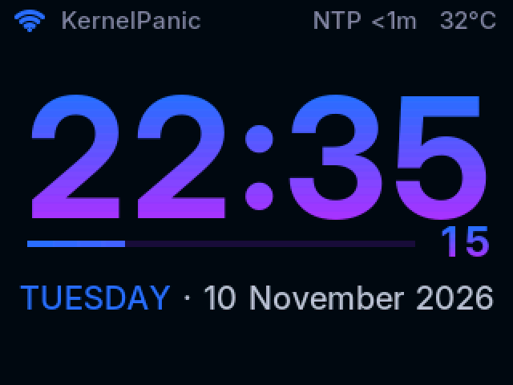

# Chrono Node

Chrono Node is an offline-first desktop smart clock built on the ESP32-2432S028R
("Cheap Yellow Display", CYD) with an external DS3231 RTC as its time source.

**Current state (M5):** a 24-hour clock driven by the DS3231 (which holds UTC), shown in
local time using a configurable POSIX timezone stored in NVS. Wi-Fi with a setup portal, mDNS
(`chrono-node.local`) and NTP that keeps the DS3231 accurate. The UI uses bold anti-aliased
gradient digits, rolling transitions and colours that follow the time of day. See
[docs/ROADMAP.md](docs/ROADMAP.md) for upcoming milestones.

| Night | Sunrise | Day |
|-------|---------|-----|
|  |  |  |
| **Sunset** | **Palettes (`TEST PALETTE`)** | **Setup mode** |
|  |  |  |

## Display

- **Status bar:** Wi-Fi signal and network name, NTP sync age (`NTP 5m`, amber when stale),
  and the DS3231 temperature (±3 °C; it's the RTC chip's own sensor).
- **Time:** HH:MM in 104 px Inter Bold with a vertical colour gradient. Changed digits roll
  upwards over 300 ms. Every digit uses a fixed-width cell, so the time never shifts sideways.
- **Minute bar:** fills over the minute with a horizontal gradient. The seconds sit at its
  right end.
- **Date:** the weekday in the accent colour, then the date.
- **Notice line:** RTC lost-power warning (red) or Wi-Fi setup instructions (cyan).
- **Colours by time of day** (on a deep navy background), blended minute by minute:
  night blue→violet, sunrise (~06:30) gold→red-pink, day (09:00–16:00) yellow→orange,
  sunset (~18:30) orange→magenta, evening (~20:30) purple→blue. The colours are fully
  saturated, because pastels look washed out on the IPS panel.
- Glyphs are rendered white-on-black into sprites, then tinted per pixel, so the gradients
  keep their anti-aliasing. Nothing flickers. An animation frame takes a few ms.
- The CYD's RGB LED is switched off at boot.

Fonts are generated from the Inter variable font (SIL Open Font License, see
`tools/fonts/OFL.txt`) into `src/fonts/*.h` by `tools/gen_fonts.py`. The headers are
committed, so builds need no extra tools. To change sizes or weights:

```bash
uv run --with freetype-py tools/gen_fonts.py
```

### Screenshots

`SHOT` on the serial console streams the screen back over USB. The helper script saves it as
a PNG:

```bash
uv run --with pyserial --with pillow tools/screenshot.py -o shot.png
uv run --with pyserial --with pillow tools/screenshot.py -o setup.png --send "WIFI PORTAL"
```

Opening the port resets most CYDs, so the script waits for boot first (`--wait`, default
8 s). A capture takes ~15 s, during which the clock pauses. Readback needs
`SPI_READ_FREQUENCY` at 6 MHz; at 20 MHz the CYD returns bit-shifted colours.

The capture reads the display's memory, so it can't show panel-level problems such as
inversion. Use `TEST` to check the real panel; see Troubleshooting.

## Time model

- The DS3231 is the source of truth and **always stores UTC**.
- Local time = DS3231 UTC + the POSIX `TZ` string (default `<+07>-7`, change it with `TZ`).
- The display always reads the DS3231, so the clock works without any network.
- Between NTP syncs the DS3231 (±2 ppm) is the reference. The ESP32 system clock (used by
  TLS/SNTP) is seeded from it on a second edge, and corrected when it drifts more than 200 ms.
- When NTP time arrives (on every Wi-Fi connect, then every 6 h), the DS3231 offset is measured
  on its next second edge. If it is off by more than 100 ms, or the DS3231 lost power, it is
  rewritten exactly on the system second boundary. Writing the seconds register restarts the
  DS3231's internal 1 Hz countdown, so both clocks tick together, typically within a few ms.
- Each measurement is logged, with a drift estimate in ppm once two measurements are an hour
  or more apart.

## Hardware

| Part | Notes |
|------|-------|
| ESP32-2432S028R (CYD) | 320×240 TFT (this unit: ST7789 IPS), CH340 USB-UART |
| DS3231 RTC module | I2C address `0x68` (ZS-042 modules also show an EEPROM at `0x57`) |

### Wiring: use the CYD **LEFT** 4-pin connector

```text
CYD LEFT CONNECTOR           DS3231
3.3V   --------------------> VCC
GPIO27 --------------------> SDA
GPIO22 --------------------> SCL
GND    --------------------> GND
```

Don't use the right "Extended IO" connector. It has no 3.3V pin, and GPIO21 is the
CYD's TFT backlight. The firmware always calls `Wire.begin(27, 22)` explicitly.

> ZS-042 style DS3231 modules include a trickle-charge circuit intended for LIR2032 cells.
> If you fit a non-rechargeable CR2032, consider removing the charge resistor or diode.

## Development setup (macOS)

```bash
uv tool install platformio      # or: brew install platformio / pipx install platformio
pio --version
```

VS Code with the PlatformIO IDE extension is optional. The CLI is enough.

## Build, flash, monitor

```bash
pio run                 # build -> .pio/build/cyd/chrono-node-fw.bin
pio device list         # find the board's port
pio run -t upload       # flash (add --upload-port <port> if several ports exist)
pio device monitor      # serial console, 115200 baud
```

All TFT_eSPI configuration lives in `platformio.ini` (`build_flags`), so a fresh
checkout builds without editing anything in the global PlatformIO packages directory.

## Connecting the device

1. Plug the CYD directly into the computer with a **data-capable** USB cable.
2. `pio device list` should show the CH340 bridge, e.g. `/dev/cu.usbserial-1210`,
   `USB VID:PID=1A86:7523`. macOS includes the CH340 driver. Boards with a CH9102
   appear as `/dev/cu.wchusbserial-*` and may need the WCH driver.
3. If uploading fails at high baud, the project already uses `upload_speed = 460800`
   (921600 is unreliable with the CH340). If auto-reset fails, hold **BOOT** while
   the upload starts connecting.

## Wi-Fi setup

The clock works without Wi-Fi. Network work runs in its own FreeRTOS task (core 0), so
connecting, scanning and the portal never pause the clock.

1. If no Wi-Fi credentials are saved, the clock opens a setup portal. The top line of the
   screen shows `Setup: join Wi-Fi Chrono-Node-XXXX`.
2. Join that open network from a phone. The captive page opens automatically, or browse to
   `http://192.168.4.1`.
3. Choose **Configure WiFi**, pick a **2.4 GHz** network, enter the password and save.
4. The top line turns green (`Wi-Fi: <network>`), and the clock answers at `chrono-node.local`.

Credentials are stored in ESP32 NVS by the Wi-Fi stack, never in the repository.

Behaviour:
- If the first connection after boot fails, the portal opens for 180 s, in case the
  network changed. Afterwards the clock retries with backoff (10 s, doubling up to 5 min).
- If credentials just entered in the portal fail, the portal reopens.
- A dropped connection is retried automatically with the same backoff.
- The portal has no firmware-update page, because the setup AP is open.

## Serial console

Firmware **never** writes the RTC at boot. Normal operation only reads the DS3231.
Open `pio device monitor` and type:

```text
SET 2026-11-08 14:32:51     # local wall-clock time, converted and stored as UTC
GET                         # current time, local and UTC
TZ                          # show the timezone
TZ <+07>-7                  # set and save a POSIX timezone (UTC+7, no DST)
TZ CET-1CEST,M3.5.0,M10.5.0/3   # example with DST rules
INFO                        # firmware/git revision, heap, partition, DS3231 temperature
WIFI                        # Wi-Fi state, SSID, IP, RSSI
WIFI PORTAL                 # open the setup portal (closes after 180 s if credentials exist)
WIFI FORGET                 # erase saved Wi-Fi credentials and open the portal
NTP                         # server, last sync age, last measured DS3231 offset
NTP SYNC                    # sync now (busy pool servers may answer only after a retry, ~15 s)
NTP SERVER time.google.com  # set and save the NTP server (default pool.ntp.org), then sync
SHOT                        # stream the screen (use tools/screenshot.py)
TEST                        # labelled colour bars for 20 s (panel variant check)
TEST PALETTE                # the five day-cycle palettes side by side for 30 s
HELP
```

`SET` rejects impossible dates and local times skipped by a DST change. With Wi-Fi
configured, `SET` is rarely needed: NTP fixes the DS3231 on the next sync.

`SET` also clears the DS3231 "oscillator stopped" (lost power) flag. If that flag is
set at boot, the serial log warns about it and the screen shows
`RTC lost power - time not set` until you set the time.

## Expected serial output

```text
[Chrono Node] Booting chrono-node-fw v0.5.0 (1a2b3c4)
[SETTINGS] TZ=<+07>-7 (saved), NTP=pool.ntp.org (default)
[DISPLAY] Initialized
[I2C] SDA=GPIO27 SCL=GPIO22 @ 100000 Hz
[RTC] DS3231 detected at 0x68
[TIME] 2026-11-08 14:32:51 +0700
[WIFI] Connecting to "MyNetwork"
[TIME] System clock seeded from DS3231
[WIFI] Connected to "MyNetwork", IP 192.168.1.93, RSSI -48 dBm
[WIFI] mDNS: chrono-node.local
[NTP] Syncing with pool.ntp.org
[NTP] Time received
[NTP] DS3231 offset -118 ms
[NTP] DS3231 corrected from NTP
```

The status bar shows the NTP sync age (`NTP 5m`, `NTP --` if never synced, `NTP stale`
in amber after 24 h without a sync).

If the RTC is missing, you get `[RTC] ERROR: DS3231 not detected` and an error
screen. The firmware keeps running and re-probes every 2 s, so a reconnected RTC is
picked up without a reboot.

To disable the once-per-second time log, set `kLogEverySecond = false` in `include/config.h`.

## Project layout

```text
platformio.ini                  board, libraries, TFT_eSPI pin configuration
partitions/chrono_node_4mb.csv  2 x 1.75 MB OTA app slots + 384 KB LittleFS
scripts/build_info.py           names artifacts chrono-node-fw.*, embeds git revision
.github/workflows/build.yml     CI: pio run + firmware artifacts
include/config.h                pins, I2C address, timing, defaults, firmware metadata
src/main.cpp                    setup/loop, DS3231 polling, system clock seeding
src/rtc_manager.*               I2C + DS3231 detection/read/write/temperature
src/time_utils.*                UTC <-> local conversion using the POSIX TZ
src/settings.*                  NVS-backed settings (timezone, NTP server)
src/net_manager.*               Wi-Fi task: connect/backoff, WiFiManager portal, mDNS, SNTP
src/clock_sync.*                DS3231 <-> system clock <-> NTP discipline
src/display_manager.*           UI: status bar, rolling digits, minute bar, date, notices, SHOT
src/ui_theme.*                  palette and time-of-day accent colour
src/fonts/*.h                   generated Inter smooth fonts (do not edit)
tools/gen_fonts.py              font generator (FreeType -> TFT_eSPI VLW arrays)
tools/screenshot.py             screen capture over USB serial
tools/fonts/                    Inter variable font + OFL licence
src/serial_console.*            SET/GET/TZ/INFO/WIFI/NTP/SHOT/HELP development commands
```

## Troubleshooting

- **Clock never joins Wi-Fi:** the ESP32 supports 2.4 GHz only. Check `WIFI` on the serial
  console for the failure reason code, then run `WIFI PORTAL` to re-enter credentials.
- **Time is off by whole hours after upgrading from v0.1.0:** v0.1.0 stored local time in
  the DS3231. Run `SET` once with the current local time.
- **White background, wrong or washed-out colours:** CYD batches use different panels. This
  project targets the ST7789 IPS panel (`ST7789_DRIVER`, BGR order, inversion off, as on the
  "CYD2USB"). The original CYD uses an ILI9341. Run `TEST`: the background must be black and
  each bar must match its label. The comment at the end of `platformio.ini` lists the flags
  for the other variant.
- **`DS3231 not detected`:** check that the RTC is on the LEFT connector and that SDA and SCL
  aren't swapped.
